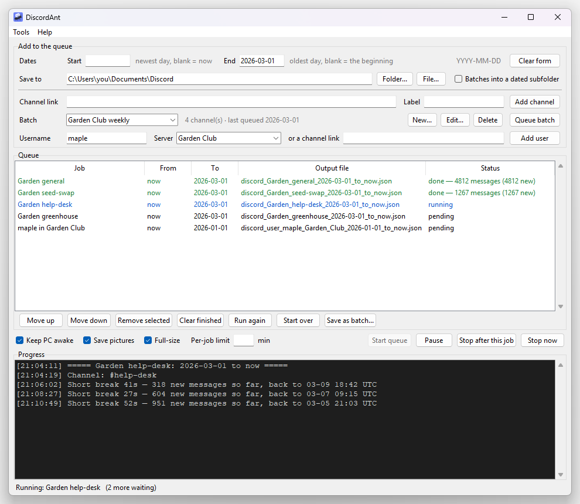

<p align="center"></p>

# DiscordAnt

DiscordAnt saves Discord conversations to files on your own PC.

It opens a real browser, you log in as yourself, and it scrolls back through a
channel at the pace of a person reading, saving what it sees. It can collect:

- **a channel**, over any dates you choose;
- **a batch**: a saved set of channels you top up with one click;
- **one person's messages** across a server, each with the conversation around it.

Pictures can be saved too. Everything goes into one archive on your PC, so a
stopped job carries on where it left off and nothing is collected twice.



> [!WARNING]
> **Use it at your own risk.** Discord does not allow automating a personal
> account ([Discord's own page on this](https://support.discord.com/hc/articles/115002192352)).
> DiscordAnt goes slowly on purpose, but nobody can promise that an account
> will not be limited or closed for using it. It only collects what your
> account can already see; treat other people's messages with care.
>
> DiscordAnt is an independent project. It is not affiliated with or endorsed
> by Discord.

## Install (Windows 10 or 11)

1. Download **DiscordAnt-Setup** from the
   [latest release](https://github.com/gordoaf/DiscordAnt/releases/latest).
2. Run it. It installs for you only, so it does not ask for an administrator
   password.
3. Open **DiscordAnt** from the Start menu or the desktop.

That is all. The installer carries everything the app needs, including its own
copy of the Chromium browser, so there is nothing else to set up and your own
Chrome or Edge is not touched. Expect a download of about 170 MB and about
560 MB on disk.

**"Windows protected your PC"** may appear when you run the installer. That
is Windows being careful with a program from a small project that has not
bought a signing certificate. Click **More info**, then **Run anyway**. Some
antivirus tools are wary for the same reason; all the source is here if you
would rather [run it from source](#run-it-from-source).

To update, run a newer installer over the top. What you collected is kept.

## Quick start

1. Fill in the **dates** and where to **save to**.
2. In Discord, right-click a channel, choose **Copy Link**, paste it into
   **Channel link** and press **Add channel**.
3. Press **Start queue**.
4. The first time, a browser window opens: **log in to Discord there once**.
   The login is remembered.
5. Leave it to work. Jobs run one after another, so a queue can be left
   running overnight.

**Help → Quick guide** in the app has a short version of this page, and
resting the mouse on a box or button shows a hint.

## Your Discord login

DiscordAnt never asks for your Discord password and has no login box of its
own.

- **You log in on Discord's own website**, in the browser window DiscordAnt
  opens. Check the address bar: it says `discord.com`. The QR code on that
  page works too, so you need not type a password at all.
- **That browser remembers you**, the way any browser does. The login is kept
  in the `chrome_profile` folder on your PC (see
  [Where your data lives](#where-your-data-lives)) and is not sent anywhere.
- **The installer carries no login.** Everyone starts logged out.
- **To log out or switch accounts**, choose **Tools → Log out of Discord**.
  It removes the saved login from this PC, and the next job asks you to log
  in again. To also end the session on Discord's side, open Discord and go to
  User Settings → Devices.

DiscordAnt does drive that browser, so you are trusting it the way you trust
any browser you log in with. That is why all the code is public: it visits
`discord.com` only, and reads only the messages, search results and pictures
that Discord's own page loads.

## Adding jobs

The top panel has two shared rows, then one row for each kind of job.

| Row | Meaning |
|---|---|
| Dates: Start | The newest day wanted. **Blank = up to now** |
| Dates: End | The oldest day wanted. **Blank = back to the very beginning** |
| Save to | A folder (each job's file is named for you), or a `.json` path to name one job's file yourself |
| Channel link | One channel. Then **Add channel** |
| Batch | A saved set of channels. Then **Queue batch** |
| Username | One person's messages in a server. Then **Add user** |

Dates are `YYYY-MM-DD`, in UTC. The dates stay in the boxes after you add a
job, so several jobs can share them; **Clear form** empties them.

### A channel

Paste the channel's link. The **Label** is optional: leave it blank and the
channel's real name is used once the app has seen it.

### A batch

A batch is a named set of channels, for the ones you come back to. **New...**
makes one: give it a name and paste the channel links. After that, pick the
batch and press **Queue batch** to get one job per channel.

Picking a batch fills in the end date with the day it was last queued, so the
default is "everything since last time". If the end date is blank the app
asks first, because that means every channel back to its beginning. Tick
**Batches into a dated subfolder** and each run gets its own folder.

### One person's messages

Everything one person posted in a server over the dates above.

- **Username** is their exact username (the @name on their profile), not
  their display name.
- **Server**: pick one the app already knows, or paste a link to any channel
  of that server.

You get a `.json` file with their messages grouped by channel, each with the
messages around it and the message it was replying to, and a `.md`
transcript of the same thing that reads like the conversation.

The app types the name into Discord's own search box, pages through the
results, then opens each conversation to read what was said around it. Only
channels your account can see are covered. Collecting the busy channels for
those dates first makes a user job much quicker, because conversations
already in the archive need no extra look-ups.

## Pictures

| Option | Meaning |
|---|---|
| Save pictures | On by default. Attachments and link previews are saved to disk |
| Full-size | On by default. Also fetches full-size copies when a job finishes. Slower; without it you keep the smaller previews |

Each message with pictures lists them in the output file, with the place each
one was saved.

## Running the queue

| Button | What it does |
|---|---|
| Start queue | Runs the waiting jobs. Also carries on any stopped or incomplete ones |
| Pause / Resume | Holds everything where it is; the browser stays open |
| Stop after this job | Finishes the running job, then stops |
| Stop now | Stops straight away. What was collected is kept |
| Run again | Re-runs the selected job. Only missing parts are collected |
| Start over | Scrolls the selected job's whole range again, to pick up edits or pictures missed the first time |
| Save as batch... | Turns the channels in the queue into a batch |

A job that fails does not stop the queue: it is marked `failed` and the next
one starts. The queue is saved and comes back the next time you open the app.

**Keep PC awake** stops the PC going to sleep while the queue runs (closing a
laptop lid still suspends it). **Per-job limit** stops a job after that many
minutes and marks it `incomplete`, ready to be carried on later.

## Nothing is collected twice

Every message is kept in one archive on your PC, with a record of which
stretches of each channel have been read in full. A job only scrolls through
the part of its dates the archive does not hold yet.

- Stopped, paused, crashed or closed mid-job: nothing is lost. Run it again
  and it carries on.
- Asking for dates you already have opens no browser at all. The file is
  simply written from the archive.
- Overlapping dates cost only the part that is new.

## What the files look like

A channel job writes one `.json` file: a list of messages, oldest first.

```json
[
 {
  "id": "1300000000000000001",
  "ts": "2026-03-01T14:05",
  "author": "maple",
  "content": "Has anyone tried the new seed mix?",
  "reactions": "👍3"
 },
 {
  "id": "1300000000000000002",
  "ts": "2026-03-01T14:07",
  "author": "birch",
  "content": "Yes, it came up in four days.",
  "reply_to": "maple: Has anyone tried the new seed mix?",
  "images": [
   {"name": "tray.jpg", "file": "C:\\Users\\you\\AppData\\Local\\DiscordAnt\\images\\...\\tray.jpg"}
  ]
 }
]
```

`id`, `ts` (UTC), `author` and `content` are always there. The others appear
when they apply: `reply_to`, `attachments`, `embeds`, `images`, `reactions`,
`stickers`, `poll`, `thread`, `forwarded`, `bot`.

A user job writes the same rows grouped by channel and then by conversation.
Rows with `"theirs": true` are the person's own; the rest are the
conversation around them.

## Where your data lives

Everything is in `%LOCALAPPDATA%\DiscordAnt\` (paste that into File
Explorer's address bar). **Tools → Open archive folder** takes you there.

| File or folder | What it is |
|---|---|
| `archive.db` | Every message collected and what has been covered |
| `images\` | The saved pictures |
| `chrome_profile\` | The browser's Discord login. Treat it like a password |
| `batches.json`, `queue.json`, `gui_settings.json` | Your batches, the queue, the options |
| `scraper.log` | The log, kept after the app closes |

The output `.json` files go wherever **Save to** points. They are written
from the archive, so a deleted output file can be made again at no cost.

Nothing leaves your PC. DiscordAnt has no account, no server and no tracking.

**Uninstalling:** Windows Settings → Apps → DiscordAnt → Uninstall. It asks
whether to delete what you collected as well; the default is to keep it.

## Why it is slow

On purpose. DiscordAnt waits about 2.5 to 5.5 seconds between scroll steps
and takes a longer break every so often, which works out at roughly 10,000 to
15,000 messages an hour. It never calls Discord's API itself. It only reads
what Discord's own page loads while it scrolls, so it asks no more of Discord
than a person reading would.

Please do not speed it up. A user job does a little more than scroll (it
types in the search box and jumps to old conversations), so keep those to
people you really need.

## Run it from source

For Windows without the installer, or to try it on Mac or Linux. Needs
Python 3.10 or newer.

```
git clone https://github.com/gordoaf/DiscordAnt.git
cd DiscordAnt
pip install -r requirements.txt
playwright install chromium
python app/gui.py
```

Only Windows is tested. On Mac and Linux the app may well run, but nobody has
checked, and "Keep PC awake" does nothing there. Reports are welcome.

## Build the installer yourself

```
pip install -r requirements-build.txt
python build.py --installer
```

This makes the app folder in `dist\`, copies the browser into it, runs the
build's self-test in an empty user folder, and packs
`release\DiscordAnt-Setup-<version>.exe`. The installer step needs
[Inno Setup 6](https://jrsoftware.org/isinfo.php).

| File | Job |
|---|---|
| `app/gui.py` | The window and the queue |
| `app/scraper_core.py` | Browser, scrolling, capture, pictures, channel files |
| `app/user_history.py` | One person's messages |
| `app/store.py` | The archive |
| `app/jobs.py` | Job naming and status rules |
| `app/keep_awake.py` | Stops the PC sleeping |
| `app/appinfo.py` | Name and version |
| `build.py`, `installer/` | The build and the installer |

## Licence

DiscordAnt's code is under the [MIT licence](LICENSE). The installer also
carries Chromium, Playwright and other software under their own licences: see
[THIRD_PARTY_NOTICES.md](THIRD_PARTY_NOTICES.md).

"Discord" is a trademark of Discord Inc. DiscordAnt is not affiliated with or
endorsed by Discord.
